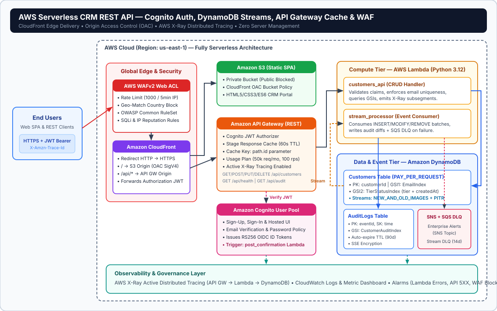
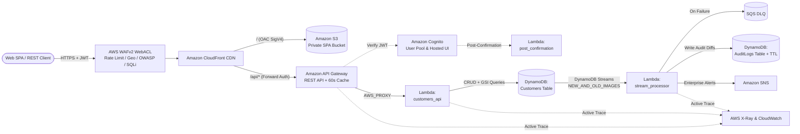

# AWS Solutions Architect – Associate Capstone Project
# Project 3: Serverless Customer Records REST API with Cognito Auth, DynamoDB & WAF

[](https://opensource.org/licenses/MIT)
[](https://www.terraform.io/)
[](https://www.python.org/)
[](https://aws.amazon.com/serverless/)

---

## Executive Summary

This project implements a fully serverless, zero-server-management **Customer Records Management (CRM)** platform on Amazon Web Services. A static Single-Page Application (SPA) hosted privately on **Amazon S3** is delivered globally through **Amazon CloudFront** with Origin Access Control (OAC) and protected at the edge by **AWS WAFv2** (rate limiting, geo-blocking, OWASP Top 10, SQL injection, and IP reputation filtering).

Backend API requests routed through `/api/*` are authenticated using **Amazon Cognito User Pools** (JWT Authorizer), accelerated with **Amazon API Gateway** stage response caching, executed by **Python 3.12 AWS Lambda** functions, persisted in **Amazon DynamoDB** with Global Secondary Indexes (GSIs), asynchronously audited via **DynamoDB Streams**, and traced end-to-end with **AWS X-Ray**.

---

## Solution Architecture Diagram



### Request & Event Flow (Mermaid)



---

## Key AWS Services & Architectural Responsibilities

| AWS Service | Role in Architecture | Configuration & Security Detail |
| :--- | :--- | :--- |
| **Amazon CloudFront + OAC** | Global Edge CDN | Serves static frontend from a private S3 bucket using SigV4 Origin Access Control (OAC); forwards `Authorization` and `X-Amzn-Trace-Id` headers to API Gateway on `/api/*`. |
| **AWS WAFv2** | Edge Application Firewall | Attached to CloudFront (`CLOUDFRONT` scope): IP rate-limiting (1000 req/5m), geo-blocking, `AWSManagedRulesCommonRuleSet`, `AWSManagedRulesSQLiRuleSet`, and `AWSManagedRulesAmazonIpReputationList`. |
| **Amazon Cognito** | Identity & Access Control | Manages user registration, email verification, Hosted UI OAuth2 flows, Post-Confirmation Lambda triggers, and signs OIDC JWT tokens verified by API Gateway. |
| **Amazon API Gateway** | Managed REST API & Cache | Enforces `COGNITO_USER_POOLS` authorization on protected endpoints, provides 60s response caching keyed by `{id}`, throttling usage plans, and CloudWatch JSON access logs. |
| **AWS Lambda (Python 3.12)** | Serverless Compute | Runs `customers_api`, `stream_processor`, and `post_confirmation` with Active X-Ray tracing and least-privilege IAM execution roles. |
| **Amazon DynamoDB + Streams** | Serverless NoSQL + CDC | `PAY_PER_REQUEST` billing, Point-in-Time Recovery (PITR), KMS/AWS-managed SSE, GSIs (`EmailIndex`, `TierStatusIndex`), and `NEW_AND_OLD_IMAGES` streams feeding audit logs with 90-day TTL. |
| **AWS X-Ray & CloudWatch** | Distributed Observability | End-to-end trace propagation (`Root=1-...`), structured CloudWatch JSON logs, metric alarms (`Lambda Errors`, `API GW 5XX`), SNS alerts, and an operational dashboard. |

---

## DynamoDB Data Model & Access Patterns

| Table | Keys | Global Secondary Indexes (GSIs) | Access Patterns |
| :--- | :--- | :--- | :--- |
| **`serverless-crm-customers`** | PK: `customerId` (`S`) | `EmailIndex` (PK: `email`)<br>`TierStatusIndex` (PK: `tier`, SK: `createdAt`) | 1. Direct lookup/update/delete by `customerId`<br>2. Uniqueness enforcement on `email` via `EmailIndex`<br>3. Chronological customer queries by subscription tier via `TierStatusIndex` |
| **`serverless-crm-audit-logs`** | PK: `eventId` (`S`), SK: `timestamp` (`S`) | `CustomerAuditIndex` (PK: `customerId`, SK: `timestamp`) | 1. Full immutable timeline of `INSERT`, `MODIFY`, `REMOVE`, and `USER_CONFIRMED` events<br>2. Per-customer change history via `CustomerAuditIndex`<br>3. Automatic 90-day record expiration via `expiresAt` TTL |

---

## AWS Well-Architected Framework Alignment

1. **Operational Excellence**: Modular Terraform Infrastructure as Code (`terraform/`), automated CI validation (`.github/workflows/ci.yml`), structured CloudWatch Logs Insights JSON logging, and single-command deploy/teardown scripts.
2. **Security**: Zero public S3 access (enforced via OAC + Public Access Block), AWS WAFv2 OWASP/SQLi/rate rules at the CloudFront edge, Cognito JWT authorization at API Gateway, least-privilege per-Lambda IAM policies, and DynamoDB encryption at rest.
3. **Reliability**: Multi-AZ serverless managed services (`Lambda`, `DynamoDB`, `API Gateway`), DynamoDB Point-in-Time Recovery (PITR), Stream event source mapping retries with `bisect_batch_on_function_error`, and an SQS Dead-Letter Queue (`stream_dlq`).
4. **Performance Efficiency**: CloudFront global edge caching for static assets, API Gateway dedicated stage response caching on read endpoints (`Cache-Control` + `cache_key_parameters`), and indexed DynamoDB GSI queries eliminating expensive full-table scans.
5. **Cost Optimization**: `PAY_PER_REQUEST` DynamoDB tables, zero idle compute charges via AWS Lambda, 90-day DynamoDB TTL auto-pruning on audit records, and 14-day CloudWatch log retention.
6. **Sustainability**: High server utilization via multi-tenant serverless compute and edge caching reducing redundant origin invocations.

---

## Repository Structure

```text
.
├── .github/workflows/ci.yml             # GitHub Actions CI: Python E2E tests + Terraform validation
├── README.md                            # Capstone architecture & operational guide
├── architecture/
│   └── architecture-diagram.svg         # High-resolution AWS Serverless architecture diagram
├── frontend/
│   ├── index.html                       # Static CRM Single Page Application (S3 + CloudFront)
│   ├── styles.css                       # Responsive dark UI styles
│   └── app.js                           # Cognito OAuth2 / Local Auth + CRUD + Telemetry client
├── lambdas/
│   ├── cognito_triggers/
│   │   └── post_confirmation.py         # Cognito Post-Confirmation trigger handler
│   ├── customers_api/
│   │   └── handler.py                   # API Gateway Lambda Proxy REST CRUD handler
│   ├── shared/
│   │   ├── store.py                     # DynamoDB production store & SQLite local simulator
│   │   └── xray_tracer.py               # AWS X-Ray subsegments & structured logger
│   └── stream_processor/
│       └── handler.py                   # DynamoDB Streams CDC audit & SNS alert processor
├── local_server/
│   └── dev_server.py                    # Full local CloudFront/WAF/Cognito/Cache/Streams simulator
├── scripts/
│   ├── test-local.sh                    # Automated unit + HTTP E2E verification suite
│   ├── deploy.sh                        # Terraform apply + S3 frontend sync
│   └── cleanup.sh                       # Full Terraform resource teardown
├── terraform/
│   ├── providers.tf                     # AWS, Archive & Random provider setup
│   ├── variables.tf                     # Configurable parameters (WAF limits, geo blocks, cache)
│   ├── dynamodb.tf                      # Customers & AuditLogs tables, GSIs, Streams, TTL
│   ├── iam.tf                           # Least-privilege execution & API GW logging roles
│   ├── cognito.tf                       # Cognito User Pool, Hosted UI Domain & Client
│   ├── lambda.tf                        # Archive bundling, Lambdas, SQS DLQ & Stream mapping
│   ├── apigateway.tf                    # REST API, Cognito authorizer, CORS, cache & usage plan
│   ├── waf_cloudfront_s3.tf             # Private S3 OAC bucket, WAFv2 ACL & CloudFront CDN
│   ├── observability.tf                 # X-Ray sampling rule, CloudWatch dashboard & SNS alarms
│   └── outputs.tf                       # CloudFront URL, Cognito Hosted UI & table outputs
└── tests/
    └── test_api_and_streams.py          # Automated integration test suite
```

---

## Quick Start: Local Simulation & Automated Testing

No AWS credentials are required to run the full serverless stack locally. The local simulator emulates CloudFront edge headers, AWS WAFv2 rules (SQLi/XSS + sliding-window rate limiting), Cognito JWT signing, API Gateway response caching, Lambda execution, DynamoDB GSIs, and synchronous DynamoDB Streams triggers.

### 1. Run the Automated Test Suite
```bash
./scripts/test-local.sh
```

Sample output:
```text
============================================================
 1. Running Python Unit & Integration Test Suite
============================================================
test_01_health_and_frontend_served ... ok
test_02_cognito_auth_required_for_protected_routes ... ok
test_03_waf_blocks_sqli_and_xss_payloads ... ok
test_04_full_cognito_crud_cache_gsi_and_streams_workflow ... ok
test_05_waf_rate_limiting_blocks_excessive_bursts ... ok
----------------------------------------------------------------------
Ran 5 tests in 1.07s — OK
```

### 2. Launch Interactive Web UI Locally
```bash
python3 local_server/dev_server.py
```
Then open `http://localhost:8080` in your browser to sign up via simulated Cognito, manage Customer records, watch API Gateway `X-Cache` hits/misses, inspect AWS X-Ray trace IDs, and view DynamoDB Streams audit records in real time.

---

## Production Deployment on AWS

### Prerequisites
- AWS Account with IAM permissions for CloudFront, WAFv2, S3, API Gateway, Cognito, Lambda, DynamoDB, X-Ray, and CloudWatch
- Terraform `>= 1.5.0` and AWS CLI v2 configured (`aws configure`)

### Deploy & Verify
```bash
cd terraform
cp terraform.tfvars.example terraform.tfvars
cd ..
./scripts/deploy.sh
```

Once deployment finishes, run the live verification checks against the outputted CloudFront URL:
```bash
./scripts/test-local.sh "https://<your-cloudfront-domain>.cloudfront.net"
```

### Teardown (Cost Management)
```bash
./scripts/cleanup.sh
```

---

## Project Information

- **Project**: AWS Solutions Architect – Associate Capstone Project (Project 3)
- **Author**: Mostafa
- **Architecture**: Serverless REST API with Amazon Cognito, API Gateway Caching, Lambda, DynamoDB Streams & AWS WAF
- **License**: MIT
